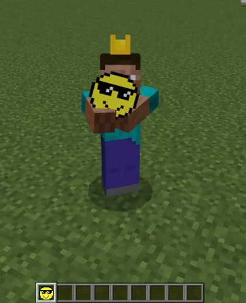

# 基岩版双手持物视觉动画（TwoHandHold-Addon）

[](https://www.minecraft.net/)
[](https://wiki.bedrock.dev/)

> **一句话概括**：不修改物品模型，而是覆盖原版玩家的动画控制器，并新增一段由 Molang 驱动的手臂动画，让角色在第三人称下呈现“双手持物”的姿势（双手持枪、双手握剑等）。

本仓库是一个可直接导入运行的最小示例：手持 `demo:gun`（游戏内显示为“双手持握测试物”）时，第三人称下右臂前举、左手扶向握持点；换回其他物品则完全恢复原版动作。

## 目录

- [效果说明](#效果说明)
- [快速体验](#快速体验)
- [实现原理](#实现原理)
- [文件结构](#文件结构)
- [改动清单](#改动清单)
- [分步实现](#分步实现)
  - [步骤一：行为包中定义触发物品](#步骤一行为包中定义触发物品)
  - [步骤二：资源包中映射物品纹理](#步骤二资源包中映射物品纹理)
  - [步骤三：新增手臂动画](#步骤三新增手臂动画)
  - [步骤四：覆盖动画控制器](#步骤四覆盖动画控制器)
  - [步骤五：覆盖客户端实体](#步骤五覆盖客户端实体)
  - [补充：为什么还要带 models 文件](#补充为什么还要带-models-文件)
- [版本升级须知](#版本升级须知)
- [调试与常见问题](#调试与常见问题)
- [改成你自己的物品](#改成你自己的物品)
- [可改进项](#可改进项)
- [参考资料](#参考资料)
- [许可证](#许可证)

## 效果说明

- **触发条件**：主手持有短名为 `gun` 的物品（本示例为 `demo:gun`）。
- **生效视角**：仅第三人称。第一人称手臂由独立的第一人称动画控制，本示例不涉及。
- **未触发时**：控制器不播放自定义动画，玩家动作与原版完全一致。

效果演示：

<div align="center">
  
</div>

## 快速体验

1. 到 [Releases](https://github.com/Dsepkcrac/Bedrock-Dual-Wield-Animation/releases) 页面下载最新版 `TwoHandHold-Addon.mcaddon`（仓库内也保留了一份源码目录：[releases/TwoHandHold-Addon.mcaddon](releases/TwoHandHold-Addon.mcaddon)）。
2. 双击该文件，Minecraft 会自动导入资源包（RP）与行为包（BP）。
3. 新建世界，在“资源包”与“行为包”页面分别启用这两个包，并开启**“假日创作者功能”**等实验性选项。
4. 进入游戏，在创造模式物品栏中找到“双手持握测试物”，手持后切换到第三人称视角。

## 实现原理

整条链路只依赖一个 Molang 判断，即 `query.get_equipped_item_name == 'gun'`：

| 环节 | 文件 | 作用 |
| --- | --- | --- |
| 触发 | `BP/items/two_hand_item.json` | 提供短名为 `gun` 的物品 |
| 判定 | `RP/animation_controllers/player.animation_controllers.json` | 原版 `root` 控制器在 `third_person` 状态下按条件挂载 `gun_controller` |
| 播放 | 同上文件中的 `controller.animation.player.gun` | 条件满足时播放 `gun` 动画 |
| 表现 | `RP/animations/player_armor.animation.json` | 改写 `rightArm` / `leftArm` 骨骼旋转 |

这里有一个绕不开的限制：**原版 `player.entity.json` 与 `player.animation_controllers.json` 无法“追加”内容，只能整份替换**。所以本包把这两个原版文件完整拷入，只在其中各加两三行。

## 文件结构

```text
TwoHandHold-Addon/
├── BP/                                          # 行为包
│   ├── manifest.json                            # data 模块，min_engine_version 1.20.0
│   └── items/
│       └── two_hand_item.json                   # demo:gun 物品定义
├── RP/                                          # 资源包
│   ├── manifest.json                            # resources 模块
│   ├── animations/
│   │   └── player_armor.animation.json          # animation.player.gun
│   ├── animation_controllers/
│   │   └── player.animation_controllers.json    # 原版整份替换 + 2 处改动
│   ├── entity/
│   │   └── player.entity.json                   # 原版整份替换 + 2 处改动
│   ├── models/
│   │   └── player_armor.json                    # 原版盔甲模型整份拷贝（未改动）
│   └── textures/
│       ├── item_texture.json                    # 纹理短名映射
│       └── items/
│           └── two_hand_item.png                # 物品图标
├── releases/
│   └── TwoHandHold-Addon.mcaddon                # 可直接导入的打包产物
└── TwoHandHold-Addon.zip                        # 源码 + releases 的归档
```

## 改动清单

| 文件 | 方式 | 关键内容 |
| --- | --- | --- |
| `BP/manifest.json` | 新增 | 行为包清单，`type: data` |
| `BP/items/two_hand_item.json` | 新增 | 物品 `demo:gun` |
| `RP/manifest.json` | 新增 | 资源包清单，`type: resources` |
| `RP/textures/item_texture.json` | 新增 | `two_hand_item` → `textures/items/two_hand_item` |
| `RP/textures/items/two_hand_item.png` | 新增 | 物品图标 |
| `RP/animations/player_armor.animation.json` | 新增 | `animation.player.gun` |
| `RP/animation_controllers/player.animation_controllers.json` | **覆盖原版** | 第 4–15 行新增 `controller.animation.player.gun`；第 273–275 行向 `third_person` 状态注入 `gun_controller` |
| `RP/entity/player.entity.json` | **覆盖原版** | 第 108–109 行注册 `gun` 与 `gun_controller` |
| `RP/models/player_armor.json` | **覆盖原版** | 原版文件，无自定义改动 |

## 分步实现

### 步骤一：行为包中定义触发物品

`BP/items/two_hand_item.json`：

```json
{
  "format_version": "1.20.50",
  "minecraft:item": {
    "description": {
      "identifier": "demo:gun",
      "menu_category": {
        "category": "items"
      }
    },
    "components": {
      "minecraft:icon": {
        "texture": "two_hand_item"
      },
      "minecraft:display_name": {
        "value": "双手持握测试物"
      },
      "minecraft:max_stack_size": 1
    }
  }
}
```

要点：

- 标识符必须带命名空间（`demo:gun`）。Molang 查询的是**不带命名空间的短名**，所以后面判断的是 `'gun'`。
- `minecraft:icon.texture` 填的是纹理短名，需与 `item_texture.json` 中的键一致。
- `max_stack_size: 1` 是为了让手持状态稳定，避免堆叠时姿势判断出现歧义。

### 步骤二：资源包中映射物品纹理

`RP/textures/item_texture.json`：

```json
{
  "resource_pack_name": "two_hand_hold",
  "texture_name": "atlas.items",
  "texture_data": {
    "two_hand_item": {
      "textures": "textures/items/two_hand_item"
    }
  }
}
```

图片放在 `RP/textures/items/two_hand_item.png`，路径不带扩展名。

### 步骤三：新增手臂动画

`RP/animations/player_armor.animation.json`：

```json
{
  "format_version": "1.8.0",
  "animations": {
    "animation.player.gun": {
      "loop": true,
      "bones": {
        "rightArm": {
          "rotation": ["-90 - this", 0, 0]
        },
        "leftArm": {
          "rotation": [-77.7968, 51.8659, 9.654]
        }
      }
    }
  }
}
```

这里是整套方案最关键的一处技巧：

- `this` 表示该通道**当前已累积的角度**，也就是原版动画（行走、挥击、潜行等）已经算好的手臂旋转。`"-90 - this"` 相当于先把原版角度抵消掉，再把手臂强制转到 `-90°`，因此无论玩家在跑动还是攻击，手臂都稳定前举。
- 左手用固定角度（`[-77.7968, 51.8659, 9.654]`）搭向右手握持点，这三个值是逐帧调出来的经验值。
- `loop: true` 让动画持续生效，配合控制器实现“开关”式的切换。

### 步骤四：覆盖动画控制器

`RP/animation_controllers/player.animation_controllers.json` 是原版文件的完整拷贝，共 292 行，改动只有两处。

**改动一**：在 `animation_controllers` 顶层新增一个控制器（第 4–15 行），结构如下：

```json
{
  "animation_controllers": {
    "controller.animation.player.gun": {
      "initial_state": "default",
      "states": {
        "default": {
          "animations": [
            { "gun": "query.get_equipped_item_name == 'gun'" }
          ]
        }
      }
    }
  }
}
```

它只有一个状态，靠条件表达式决定动画是否生效，所以不需要 `transitions`。

**改动二**：在 `controller.animation.player.root` 的 `third_person` 状态里，向 `animations` 数组末尾追加（第 273–275 行）：

```json
{
  "gun_controller": "query.get_equipped_item_name == 'gun'"
}
```

要点：

- 这两处的 Molang 判断相同，看似重复，但缺一不可：第二处决定“控制器要不要跑”，第一处决定“动画要不要播”。
- `gun`、`gun_controller` 都是短名，必须在客户端实体文件里映射到动画/控制器全名（见下一步）。
- 也可以把 `controller.animation.player.gun` 单独放进一个新文件，但这样它没有入口：玩家的 `scripts.animate` 只有 `root`，要让 `root` 调用它就必须改 `root` 控制器，而 `root` 已由原版定义，改动等于整份替换。本示例因此把两处改动合并进同一个文件。

### 步骤五：覆盖客户端实体

`RP/entity/player.entity.json` 是原版文件的完整拷贝，共 131 行，改动是在 `description.animations` 末尾追加两行（第 108–109 行），追加后相当于：

```json
{
  "animations": {
    "gun": "animation.player.gun",
    "gun_controller": "controller.animation.player.gun"
  }
}
```

注意 `scripts.animate` 仍然只有 `["root"]`，并没有直接把 `gun_controller` 写进去。自定义控制器是由 `root` 的 `third_person` 状态按条件调用的，这样才不会在第一人称和纸娃娃（paperdoll）视角下误播。

### 补充：为什么还要带 models 文件

`RP/models/player_armor.json` 是原版玩家盔甲模型的完整拷贝，本示例**没有做任何修改**。它定义玩家盔甲渲染所用的 `geometry.player.armor.*` 骨骼层级；只做本教程的手臂动画时并非必需，保留它是为了让包内这几份原版文件保持同一版本，避免升级后骨骼或层级对不上。

## 版本升级须知

覆盖原版文件的代价是**与引擎版本绑定**：

- 游戏升级后，新版原版文件可能新增动画、骨骼或状态。此时直接沿用旧拷贝，会出现“新特性在玩家身上丢失”的问题。
- 正确做法：从新版本的游戏资源包中重新提取 `player.entity.json`、`player.animation_controllers.json`、`player_armor.json`，再把上面列出的几行改动重新加回去。
- 建议在目录名或 README 中标注所对应的原版文件版本（如 `1.20.50`），方便日后比对。

## 调试与常见问题

**Q1：手持物品完全没有反应？**

按顺序排查：

1. 物品标识符的短名是否为 `gun`（`demo:gun` → `gun`），与两处 Molang 字符串是否完全一致。
2. `gun_controller` 是否已追加到 `root` 的 `third_person` 状态里。
3. 是否在第三人称视角下观察。
4. 是否开启了实验性选项。

**Q2：左手姿势不对，或者枪穿模？**

左手三个角度是硬编码值，与武器模型的握持点强相关。换武器后需要重新调整，也可以同时对 `rightItem` 骨骼做微调。建议在游戏中逐帧对照握持点，不要凭经验猜值。

**Q3：控制台报错找不到动画？**

检查 `player.entity.json` 中的短名映射与动画 ID 是否一字不差，注意 `animation.player.gun` 与 `controller.animation.player.gun` 的前缀区别。

**Q4：为什么动画文件叫 `player_armor.animation.json` 却在定义 `animation.player.gun`？**

文件名不影响加载，动画 ID 才决定引用关系。这是历史遗留命名，属于可以顺手改掉的小瑕疵，见下一节。

## 改成你自己的物品

1. 修改 `BP/items/two_hand_item.json` 的 `identifier`，记下短名（例如 `demo:rifle` → `rifle`）。
2. 把控制器第 10 行、第 274 行的 `'gun'` 全部替换为新短名。
3. 按新武器模型调整 `RP/animations/player_armor.animation.json` 中的角度。
4. 更新纹理与显示名，重新打包为 `.mcaddon`。

搜索建议：在项目里搜索 `'gun'`，共 7 处命中（物品标识符 1 处、动画 ID 1 处、控制器声明 1 处、Molang 判断 2 处、实体映射 2 处），逐一确认。

## 可改进项

以下是当前示例中可继续改进的地方，都不影响运行，可作为维护清单：

- **命名不一致**：`player_armor.animation.json` 建议改名为 `gun.animation.json`，与动画 ID 对应。
- **版本号不统一**：`manifest.json` 的 `min_engine_version` 是 `1.20.0`，而物品的 `format_version` 是 `1.20.50`，建议统一提升到 `1.20.50`。
- **缩进不统一**：`controller.animation.player.gun` 块的缩进层级比其他控制器浅，建议格式化后再提交。
- **缺少语言文件**：显示名直接写在物品组件里，多语言场景建议改用 `RP/texts/*.lang` + `minecraft:display_name` 的键值形式。
- **未适配第一人称**：第一人称持物仍是原版动作，如需一致效果要另写第一人称动画。

## 参考资料

- [Microsoft Learn：Minecraft Creator 文档](https://learn.microsoft.com/minecraft/creator/)
- [Bedrock Wiki：附加包开发指南](https://wiki.bedrock.dev/)
- [Blockbench：模型与动画编辑](https://www.blockbench.net/)

## 许可证

本项目基于 [MIT 许可证](LICENSE) 发布，版权归 © 2026 Dsepkcrac 所有。转载、修改、二次分发请保留原始版权声明。


